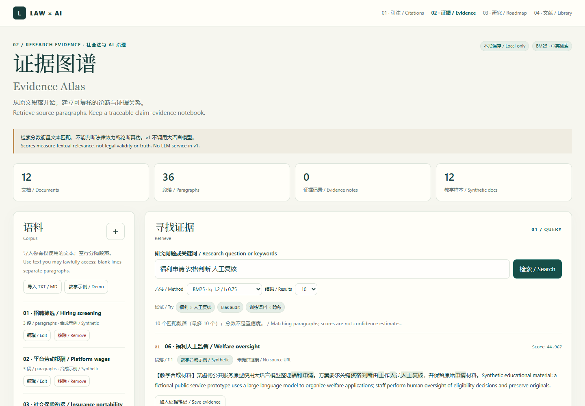

# 02-evidence-atlas · 证据图谱

**可复核的段落检索与论断—证据笔记 / Auditable paragraph retrieval and a claim–evidence notebook.**

[在线演示 / Live demo](https://josephsun1854.github.io/02-evidence-atlas/) · [方法 / Method](docs/method.md) · [实验报告 / Benchmark](docs/benchmark.md) · [Law × AI](https://josephsun1854.github.io/JosephSun1854/)



## 研究问题 / Research question

社会法与大语言模型规制研究经常需要回到原文：某项招聘评估遗漏了什么？福利申请中的人工复核如何安排？一个论断究竟引用了哪份材料的哪一段？Evidence Atlas 把“找到段落”和“判断段落与论断的关系”放在同一个本地工作流中。

Research on social law and LLM governance needs source-level traceability: what does a hiring audit omit, how is welfare eligibility reviewed, and which passage supports a claim? Evidence Atlas combines lexical paragraph retrieval with a human-annotated evidence notebook.

v1 使用真实实现的 BM25 与词频基线，不接入模型 API，不生成答案，也不自动判断法律效力。它是法律 AI 与 RAG 研究中的可审计检索、标注和评价基础，而不是法律咨询系统。

v1 implements BM25 and a token-frequency baseline. It calls no model API, generates no answers, and does not determine legal validity. It provides an auditable retrieval, annotation, and evaluation substrate for legal AI and RAG research.

## 功能 / Features

- 粘贴文本或批量导入 TXT / Markdown；为文档保存标题与 http(s) 来源链接。/ Paste text or import TXT / Markdown files with titles and optional source URLs.
- 空行分段；中文单字与相邻双字 token、英文词 token；BM25 段落排序与分数构成。/ Blank-line paragraphs, Chinese unigram/bigram and English word tokens, ranked BM25 retrieval with per-term score explanations.
- 保存论断与原文，人工标注支持、反对、背景或待复核。/ Save claims and exact passages; annotate support, opposition, context, or review needs.
- 编辑、移除文档，编辑、删除笔记；原文变化后保留原始摘录并明确标注快照状态。/ Edit/remove documents and notes; source changes preserve the original quote and show snapshot status.
- 导出 Markdown 笔记、来源定位文本、JSON 备份；完整校验通过后才替换现有数据。/ Export Markdown, source locators, and JSON; validate a full backup before replacing existing data.
- 浏览器本地保存，无账户、无上传、无第三方依赖。/ Browser-local storage; no account, upload, or third-party dependency.
- 内置 12 份中英合成文档、36 个段落与 30 个固定查询，包括 6 个改写挑战；比较 Recall@5 与 MRR。/ 12 bilingual synthetic documents, 36 paragraphs, and 30 fixed queries, including 6 paraphrase challenges; compare Recall@5 and MRR.

## 使用 / Use

1. 打开演示，点击“教学示例 / Demo”，或导入你有权使用的文本。/ Open the demo and load synthetic examples or import text you may lawfully access.
2. 输入研究问题中的具体词语；展开分数明细查看匹配依据。/ Search with concrete source-text terms and inspect score contributions.
3. 在结果中点击“加入证据笔记”，填写论断和人工判断。/ Save a passage, write your claim, and assess its relationship.
4. 定期导出 JSON；整理成果时导出 Markdown 与来源定位。/ Export JSON regularly; use Markdown and source locators in your research workflow.

“来源定位 / Citations”导出提供文档名、段落位置和来源链接，并非经过核验的法律引注格式。导入链接不会触发网页访问或真实性核验。段落编号是当前导入文本的位置，不是原始 PDF 页码。

The citations export contains document titles, paragraph positions, and source URLs; it is not validated legal citation formatting. URLs are not fetched or authenticated. Paragraph numbers locate imported text, not original PDF pages.

## 复现与部署 / Reproduce and deploy

页面由 `index.html`、`styles.css`、`engine.js`、`sample-corpus.js`、`app.js` 构成。无构建步骤。GitHub Pages 可直接从 `main` 根目录部署。本地可用任意静态 HTTP 服务打开；直接 `file://` 打开在不同浏览器中可能采用不同的存储规则。

The application is a static site with no build step. Deploy the repository root of `main` to GitHub Pages or use a local static HTTP server. Browser storage behavior for direct `file://` opening varies.

With Node.js 20 or later:

```text
npm run check
npm test
npm run benchmark
```

无须安装 npm 依赖。CI 检验算法、边界输入、快照与导出，并检查提交的实验报告是否可复现。

No npm dependencies are required. CI verifies the algorithm, invalid inputs, snapshots, exports, and reproducibility of the committed benchmark.

## 数据与边界 / Data and limits

数据保存在当前浏览器、当前站点的 `localStorage` 中；浏览器清理数据、无痕模式结束或存储禁用会影响保留。存储失败会明确提示当前修改仅在页面内保留。其他标签页的数据变动会给出提示。建议先导出再刷新，避免覆盖需要保留的版本。

Data lives in the current browser origin's `localStorage`. Clearing browser data, ending a private session, or disabling storage affects persistence. Storage failures show a visible warning that changes remain in memory only. Changes from another tab trigger a warning; export before reloading if you need the current version.

资源上限为 60 份文档、每份 120,000 字元、语料总计 1,200,000 字元与 8,000 段、1,000 条证据记录；单个文本文件最多 2 MB，备份最多 8 MB。一次批量导入中的任何文档无效，整批不写入。备份校验失败保留原有状态；来源变化后的摘录只能作为历史快照复核。

Limits: 60 documents, 120,000 characters each, 1.2 million corpus characters, 8,000 paragraphs, and 1,000 evidence notes; 2 MB per text file and 8 MB per backup. Any invalid file rejects the entire batch. Invalid backups leave the current state intact. Changed-source quotes remain historical snapshots requiring review.

合成示例不是法规、判例或政策。检索分数不是置信度，用户选择的“支持”也不是自动证明。小规模词汇对齐实验不能说明真实法律语料中的效果；改写挑战显示了词语检索的局限。版本指纹用于提示文本变化，采用非密码学散列，不是真实性或完整性认证。

Synthetic examples are not laws, cases, or policies. Scores are not confidence estimates; a user-marked supporting passage is not proof. Small vocabulary-aligned tests do not establish performance on real legal corpora; paraphrase challenges expose lexical limits. Version fingerprints detect ordinary source changes using a non-cryptographic hash, not authenticity certification.

## 下一步 / Next research steps

在有权使用、经过来源核验的真实语料上扩充人工相关性标注；比较分词、分段和排序策略；增加嵌入检索时保留 BM25 基线；为未来的 RAG 输出建立逐条来源定位与失效记录。

Extend human relevance labels on authorized, source-verified real corpora; compare tokenization, segmentation, and ranking strategies; retain BM25 as a baseline when adding embeddings; record passage-level provenance and failure cases for future RAG outputs.

[MIT License](LICENSE) · [JosephSun1854](https://github.com/JosephSun1854)
